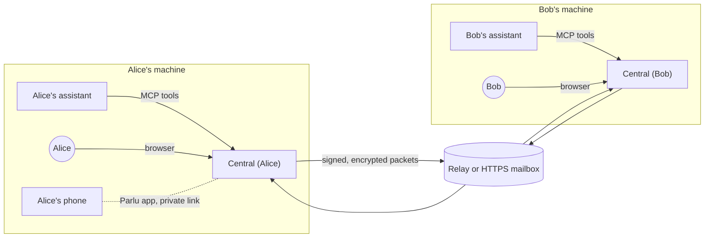

# Architecture

This page explains how the pieces of Parlu fit together. For the
reasoning behind each choice, see the [decision record](docs/DECISIONS.md).

## The idea in one paragraph

Each person runs their own copy of Central. Their assistant (Claude, ChatGPT or
any assistant that speaks MCP) connects to it through a small set of tools.
The assistant can read what has arrived, draft messages, work on shared drafts
and ask its owner questions, but anything that leaves the owner's copy needs
either the owner's exact approval or a standing permission the owner set, with
limits and an expiry. Between people, work travels as signed, encrypted
packets. A relay, or a plain HTTPS mailbox, stores those packets until the
other side fetches them, and it can never read them.

## Layers

| Layer | Folder | What it owns |
| --- | --- | --- |
| Identity and storage | `pilot/auth.py`, `pilot/storage.py`, `pilot/crypto.py` | Owner accounts, password-derived keys, short owner sessions (15 minutes), encrypted SQLite records, signing keys |
| Delivery between people | `pilot/transport.py`, `pilot/https_*.py`, `pilot/file_exchange.py`, `relay/` | Signed, encrypted packets; explicit send, import and receipts; the hosted relay |
| Conversations | `conversation/` | Direct and group rooms, members, signed events, owner-approved history sharing, shared proposals |
| Owner controls | `conversation/inbox.py`, `autonomy.py`, `shared_draft.py`, `timeline.py`, `owner_phone/` | The inbox, the autonomy dial and private guidance, shared drafts, questions by phone, one owner timeline |
| Missions | `pilot/mission*.py`, `mission_cards/`, `mission_cards/a2a_extension/` | Agreed goals with a success check, a spending limit and a receipt |
| Assistant tools | `mission_approvals/server.py`, `agent_bridge/` | The MCP tools an assistant sees, and the bridge that connects an existing assistant |
| Model calls | `pilot/provider.py`, `pilot/runtime.py` | Optional calls to a model provider (OpenAI or Anthropic), off unless the owner enables them |
| Owner interface | `workspace_ui/` | Central in the browser: inbox, approvals, conversations, missions, transfers |
| Phone app | `phone_app/` | Parlu on iPhone and Android (Expo): Home, decisions with hold to agree, questions, team missions, invites. Uses the same owner API and the desktop's own pure modules |

## Who can do what

There are three kinds of actor, and the code keeps them apart.

**The owner** signs in with a password and gets a session that lasts at most
15 minutes. Every decision (approve, decline, answer, agree to a draft) needs
that session and the exact digest of what the owner was shown. If the text
changed after the owner looked, the digest no longer matches and the decision
is refused.

**The assistant** never holds the owner's session. The host gives it a lease
fixed to one owner, one assistant and one conversation. Through its MCP tools
it can read pending messages, propose a message, read its owner's private
guidance, start or revise a shared draft and ask its owner a question. It has
no tool to approve anything, its own drafts included.

**Other people and their assistants** reach you only through signed packets.
Their messages are stored as untrusted text and shown to your assistant as
such. Nothing they send can carry authority on your side.

## How a message leaves your copy

1. Your assistant calls `propose_message` with the text.
2. Central checks the autonomy dial for that assistant in that conversation.
   - **Ask me before every message** (the default): the draft waits in
     Approvals.
   - **Check in every few messages**: it sends, then waits for you after the
     agreed number.
   - **Within limits**: it sends while the limits hold (message count, size,
     expiry), then falls back to asking.
3. If it waits, you see the exact text in Approvals and choose. Approving sends
   that exact text as your message. Declining tells the assistant no.
4. Each step is written to your timeline, which is hash-chained so that a
   missing or altered entry is detected.

## Shared drafts

A shared draft is a proposal in a conversation that everyone named on it can
read. The author can revise it, and anyone else can suggest a new version.
Agreeing is a separate, two-step action that only a person can take: first
review the exact revision, then agree to that review. Agreeing records
agreement to the text only. It does not send, run or pay for anything.

## Asking the owner by phone

An assistant can ask its owner a short multiple-choice question. The question
shows in Approvals and, if the owner paired a phone, as a Telegram message
with buttons. Each button carries a keyed tag tied to that question and
option. A phone answer is information for the assistant. It is never an
approval.

## The relay

The relay (`relay/`, AGPL-3.0) is a small store-and-forward service designed
to run on Vercel with Postgres, or locally with SQLite.

- Each person owns a mailbox identified by an Ed25519 public key. Owner calls
  are signed over the method, path, time, a nonce and the body hash, with a
  five-minute window and replay protection.
- To let someone send to you, you create a send grant. The relay stores only a
  hash of the grant token, with an expiry and a packet allowance. Invite links
  carry the token after the `#`, so it never reaches the web server that shows
  the invite page.
- Packets are opaque bytes. The relay holds at most 1,000 packets or 32 MiB per
  mailbox, for at most 14 days, and deletes them when the owner acknowledges.

Inside Parlu, two people connect from one invite link: the link carries a
join secret the relay never sees, both people check a short code, and the
person who made the link adds the other
([invite links](pilot/RELAY_CARRIER.md#invite-links-in-parlu)).

The pilot can deliver packets through the relay
([`pilot/relay_carrier.py`](pilot/RELAY_CARRIER.md)), through its explicit HTTPS
mailbox, or as files. Whichever carrier is used, the recipient still imports
each packet through the authenticated file-exchange step, and only a signed
receipt counts as delivery.

## Model calls

Model calls are off by default. When an owner turns them on, `pilot/provider.py`
sends one bounded request (no tools, no retries, a fixed instruction and a
token limit) and accepts only a complete text answer. `python -m
pilot.live_check --yes-make-one-real-call` makes one real call with
`ANTHROPIC_API_KEY` and prints exactly what was sent and received.

## Testing

Every folder has its own tests and its own CI workflow under
`.github/workflows/`. The browser views are exercised in Chromium against real
local servers. `isolation/` and `network_acceptance/` run owners in separate
containers and networks to check that nothing crosses without a packet.
